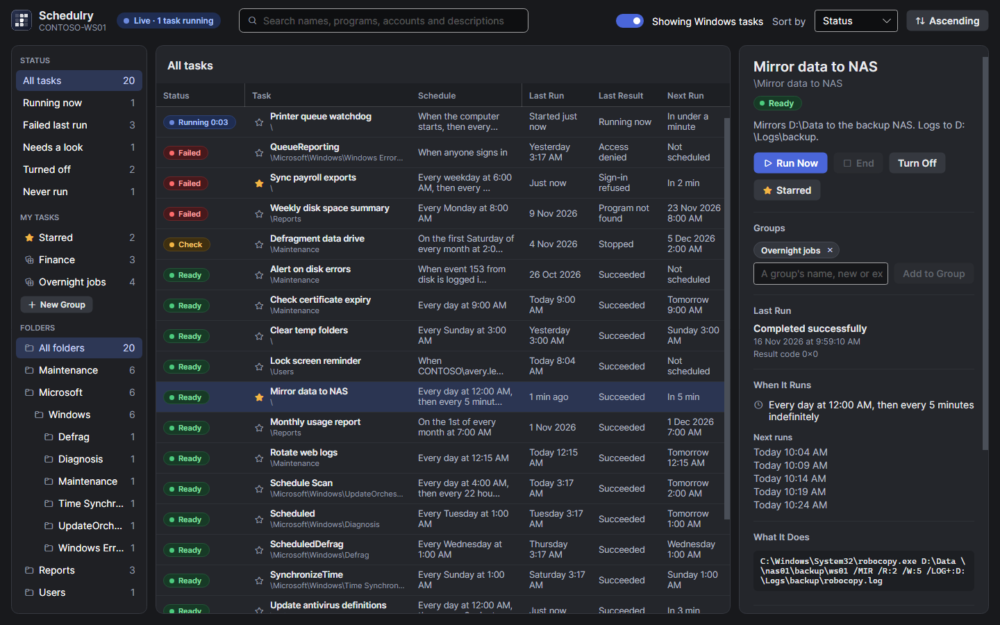
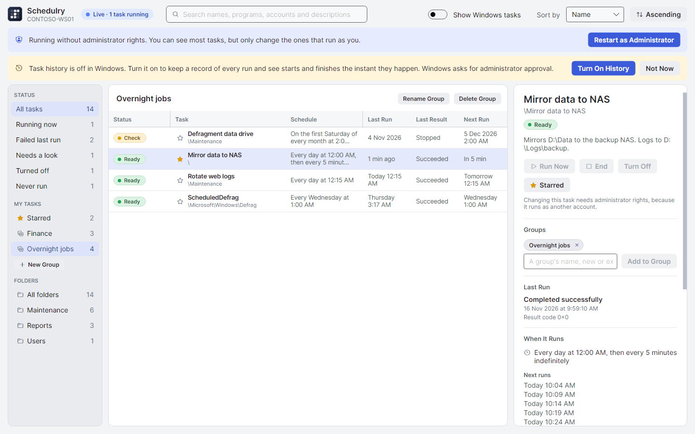

# Schedulry

A friendlier window onto Windows Task Scheduler. It shows every scheduled task on the computer
in one searchable list that updates by itself, so you see a task start, finish or fail without
pressing Refresh, and it says what each task does in plain words.


**Status: early development.** Browsing, live status, stars and groups, Run, End and turning tasks on or off work
today. Editing, remote computers, notifications and installers are on the way.

## What it does differently

| Task Scheduler | Schedulry |
|---|---|
| Press F5 to see whether anything changed | The list is live: running tasks show a ticking timer, and rows glow briefly when they change |
| `0x41301`, `0x800710E0`, `0x80070569` | "Still running", "Refused to start", "Sign-in refused: the account lacks the Log on as a batch job right", with what to do about it |
| Triggers listed as separate rows in a dialog | "Every weekday at 6:00 AM, then every 2 minutes for 12 hours", plus the next five run times |
| One folder at a time | Search across every folder by name, program, account or description; filter by Running, Failed, Needs a look, Turned off, Never run |
| "Run whether user is logged on or not" and "Do not store password" | What that means for this task, in a sentence |
| Windows' own 200 tasks mixed in with yours | Hidden until you switch them on |
| Columns you can't make wider | Drag column edges and headers, and the divider beside the preview; your layout is remembered |
| Folders are the only way to arrange tasks, and moving one changes it | Star tasks and put them in your own groups (a task can be in several); kept by Schedulry, so the tasks themselves never change |





## Running it

Requires Windows 10 or 11 and the .NET 10 SDK.

```sh
dotnet test Schedulry.slnx
dotnet run --project src/Schedulry.App
```

Add `-- --demo` to open a made-up computer whose tasks start and finish on their own.

Schedulry opens without a UAC prompt. You can see most tasks that way and change the ones that
run as you; **Restart as Administrator** unlocks the rest. Windows keeps no task history by
default; **Turn On History** switches it on (with your approval), which also makes starts and
finishes appear the instant they happen.

## How the live view works

`LiveMonitor` keeps a copy of every task and asks Task Scheduler, on a background thread:

- every 2 seconds, which tasks are running (a start or finish re-reads just that task);
- every 6 seconds, the state and last result of your tasks, and every 36 seconds of Windows' own;
- every minute, everything, to catch tasks added, changed or deleted elsewhere;
- and, once the history log is on, each event as it's written, so a change shows at once.

## Screenshots

`tools/Schedulry.Snapshots` renders the main screens from the demo computer in light and dark,
with no window:

```sh
dotnet run --project tools/Schedulry.Snapshots -- snapshots-out
```

## Icon

`tools/icon/render-icon.ps1` draws the icon (a grid read as a calendar, lit as an S, with a
clock in the middle) and writes the `.ico` and PNGs into `src/Schedulry.App/Assets`.

## Contributing: the leak guard

Nothing from a real computer (machine names, accounts, paths) may enter this repository. Git
hooks in `tools/hooks` refuse any commit or push that contains a term from a private denylist
kept **outside** the repository.

One-time setup after cloning:

```sh
git config core.hooksPath tools/hooks
```

Then create the denylist, one case-insensitive term per line (an empty file is fine):

- Windows: `%APPDATA%\schedulry-dev\denylist.txt`
- or set `SCHEDULRY_DENYLIST` to its path.

## Licence

MIT. Uses [TaskScheduler](https://github.com/dahall/TaskScheduler) (MIT),
[Avalonia](https://avaloniaui.net) (MIT), [FluentIcons](https://github.com/davidxuang/FluentIcons) (MIT)
and [CommunityToolkit.Mvvm](https://github.com/CommunityToolkit/dotnet) (MIT).
