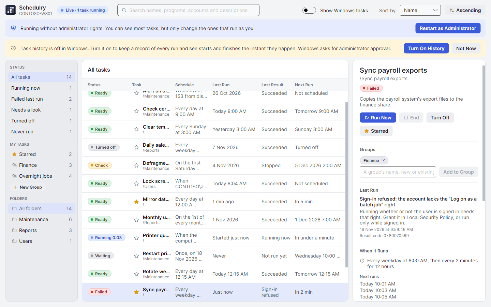
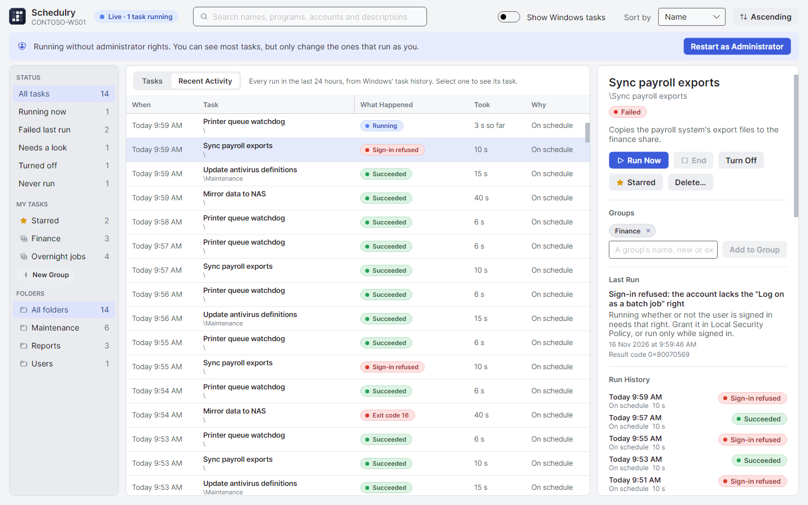
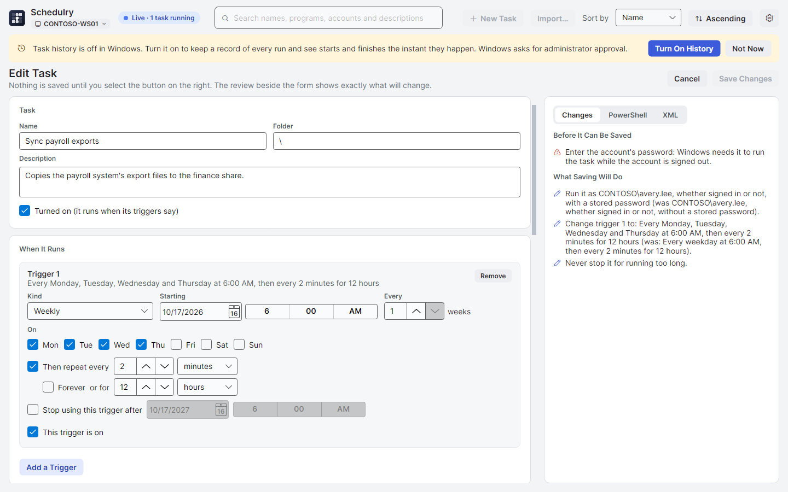
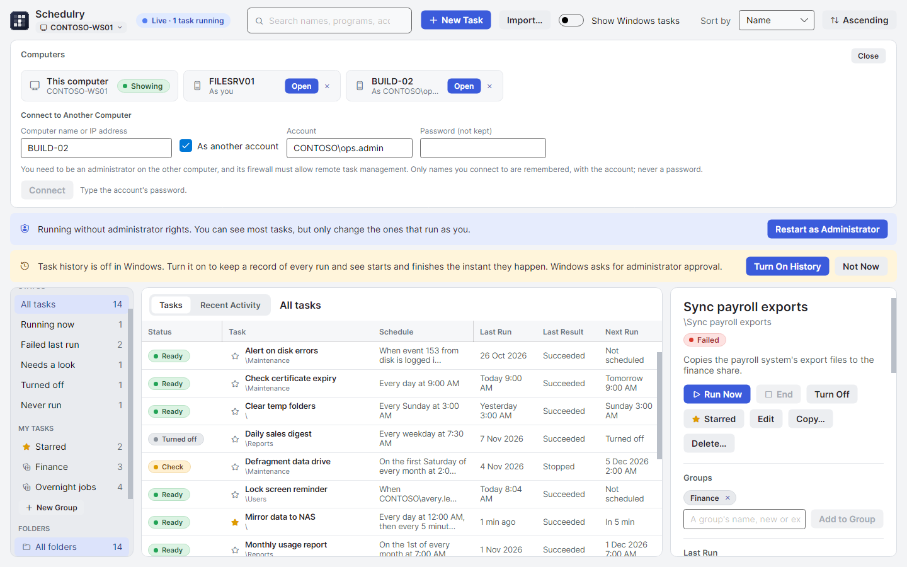

# Schedulry

A friendlier window onto Windows Task Scheduler. It shows every scheduled task on the computer
in one searchable list that updates by itself, so you see a task start, finish or fail without
pressing Refresh, and it says what each task does in plain words.

[](https://github.com/levinium/Schedulry/releases)
[](https://github.com/levinium/Schedulry/releases)

[](https://github.com/sponsors/levinium)



**Status: early development.** Browsing, live status, run history, editing, creating and importing tasks, stars and groups, Run, End and Delete work
today, on this computer or another one on the network, with a notification when a task fails.

## Download

**[Download Schedulry-win-x64-Setup.exe](https://github.com/levinium/Schedulry/releases/download/v0.1.1/Schedulry-win-x64-Setup.exe)** (71 MB)

On an Arm PC, get **[Schedulry-win-arm64-Setup.exe](https://github.com/levinium/Schedulry/releases/download/v0.1.1/Schedulry-win-arm64-Setup.exe)** (67 MB)
instead. To run it without installing, there is a portable zip for each beside them on the
[releases page](https://github.com/levinium/Schedulry/releases).

It installs for you alone, without administrator rights, and adds itself to the Start menu. It
updates itself: a newer release downloads in the background and installs when Schedulry
restarts. You need Windows 10 or 11.

Builds are not code-signed yet, so Windows SmartScreen warns before the first run. Choose
**More info**, then **Run anyway**, or read the source and build it yourself.

Your settings, stars, groups and saved computers are kept in `%APPDATA%\Schedulry`, and stay
there if you uninstall.

## What it does differently

| Task Scheduler | Schedulry |
|---|---|
| Press F5 to see whether anything changed | The list is live: a running task shows how long it has been going, and its status badge pulses when a run starts or finishes |
| `0x41301`, `0x800710E0`, `0x80070569` | "Still running", "Refused to start", "Sign-in refused: the account lacks the Log on as a batch job right", with what to do about it |
| Triggers listed as separate rows in a dialog | "Every weekday at 6:00 AM, then every 2 minutes for 12 hours", plus the next five run times |
| History hidden in a tab of event IDs, off by default | Each task's runs as a list (when, why, how long, how it ended), and a Recent Activity view of every run in the last day |
| Nested dialogs: a tab per part, a dialog per trigger, a password prompt you can't predict | One page, every field visible; beside it, what saving will change in sentences, plus the same task as PowerShell and XML |
| One folder at a time | Search across every folder by name, program, account or description; filter by Running, Failed, Needs a look, Turned off, Never run |
| "Run whether user is logged on or not" and "Do not store password" | What that means for this task, in a sentence |
| Windows' own 200 tasks mixed in with yours | Hidden until you switch them on |
| Columns you can't make wider | Drag column edges and headers, and the divider beside the preview; your layout is remembered |
| Folders are the only way to arrange tasks, and moving one changes it | Star tasks and put them in your own groups (a task can be in several); kept by Schedulry, so the tasks themselves never change |
| A failed task stays quiet until you happen to open the window | A Windows notification when a run fails, even with the window closed (Schedulry keeps watching from the notification area); Windows' own tasks are left out unless you want them, and Alerts in a task's preview turns them off for that task |
| Connect to Another Computer, then type the name again next time; "The RPC server is unavailable" | Computers you've used are one click away (with the account; a password only if you tick Remember, kept in Windows Credential Manager), and a failure says what to check: the name, the firewall rule, the account |








## Running it from source

Requires Windows 10 or 11 and the .NET 10 SDK.

```sh
dotnet test Schedulry.slnx
dotnet run --project src/Schedulry.App
```

Add `-- --demo` to open a made-up computer whose tasks start and finish on their own.

Schedulry opens without a UAC prompt. You can see most tasks that way and change the ones that
run as you; **Restart as Administrator** unlocks the rest. Windows keeps no task history by
default; **Turn On History** switches it on (with your approval), which also makes starts and
finishes appear the instant they happen.

Closing the window leaves Schedulry in the notification area, watching for failed runs; its
icon there opens it again or exits. **Settings** (the gear) turns that off, chooses which
failures send a notification, and can start Schedulry with Windows. Only one copy runs at a
time: starting it again brings the running one forward.

To manage a computer's tasks from another one, the computer being managed has to let it in:
Windows ships the firewall rules for remote task management turned off, and the other computer
then gets "The request is not supported". On that computer, **Settings** → **Let other
computers manage this PC's tasks** turns on the rule groups *Remote Scheduled Tasks Management*
and *Remote Event Log Management* (with your approval). Without Schedulry there, the same in an
administrator PowerShell:

```powershell
Enable-NetFirewallRule -DisplayGroup 'Remote Scheduled Tasks Management','Remote Event Log Management'
```

Connecting still takes an administrator account on that computer.

## How the live view works

`LiveMonitor` keeps a copy of every task and asks Task Scheduler, on a background thread:

- every 2 seconds, which tasks are running (a start or finish re-reads just that task);
- every 6 seconds, the state and last result of your tasks, and every 36 seconds of Windows' own;
- every minute, everything, to catch tasks added, changed or deleted elsewhere;
- and, once the history log is on, each event as it's written, so a change shows at once.

While the window is closed or minimised it asks five times less often. A failure still shows
within about half a minute, or at once with the history log on.

## Screenshots

`tools/Schedulry.Snapshots` renders the main screens from the demo computer in light and dark,
with no window:

```sh
dotnet run --project tools/Schedulry.Snapshots -- snapshots-out
```

## Icon

`tools/icon/render-icon.ps1` draws the icon (a grid read as a calendar, lit as an S) and writes the `.ico` and PNGs into `src/Schedulry.App/Assets`.

## Contributing: the leak guard

Nothing from a real computer (machine names, accounts, paths) may enter this repository. Git
hooks in `tools/hooks` refuse any commit or push that contains a term from a private denylist
kept **outside** the repository.

One-time setup after cloning:

```sh
git config core.hooksPath tools/hooks
```

Then create the denylist, one case-insensitive term per line (an empty file is fine):

- Windows: `%APPDATA%\schedulry-dev\denylist.txt`
- or set `SCHEDULRY_DENYLIST` to its path.

## Licence

MIT. Uses [TaskScheduler](https://github.com/dahall/TaskScheduler) (MIT),
[Avalonia](https://avaloniaui.net) (MIT), [FluentIcons](https://github.com/davidxuang/FluentIcons) (MIT)
and [CommunityToolkit.Mvvm](https://github.com/CommunityToolkit/dotnet) (MIT).
